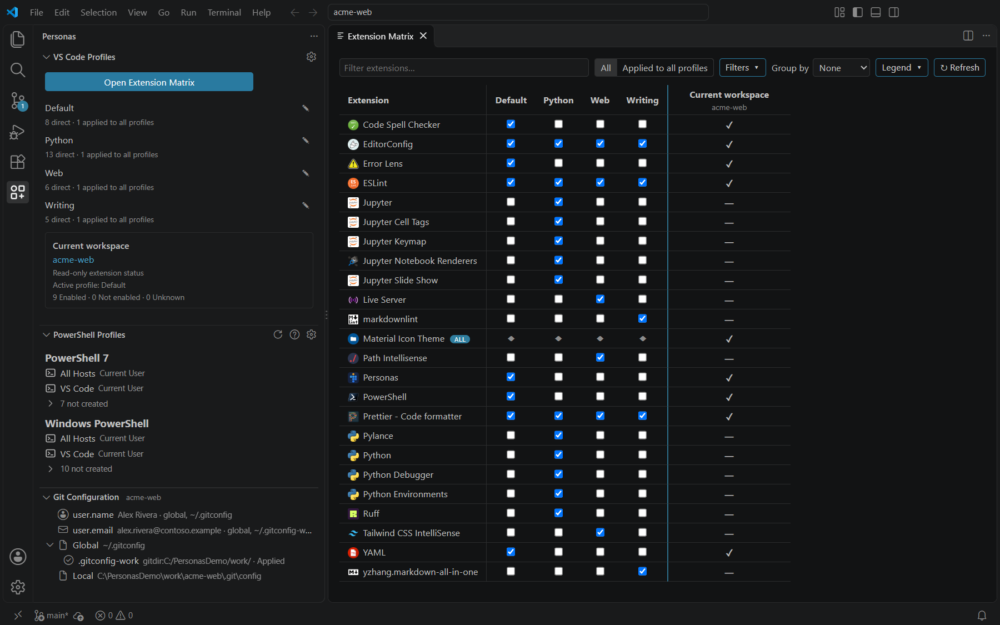
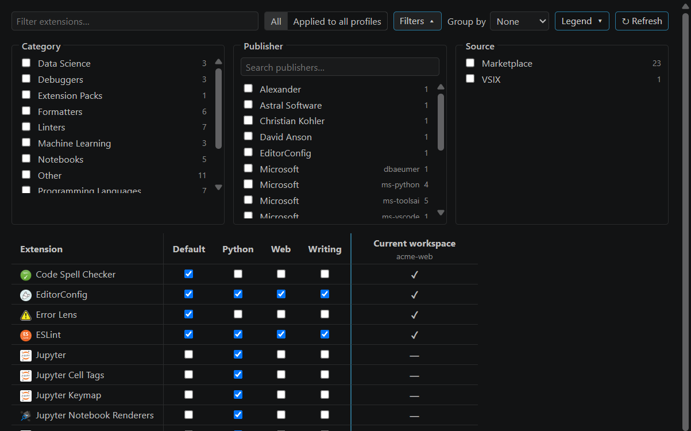
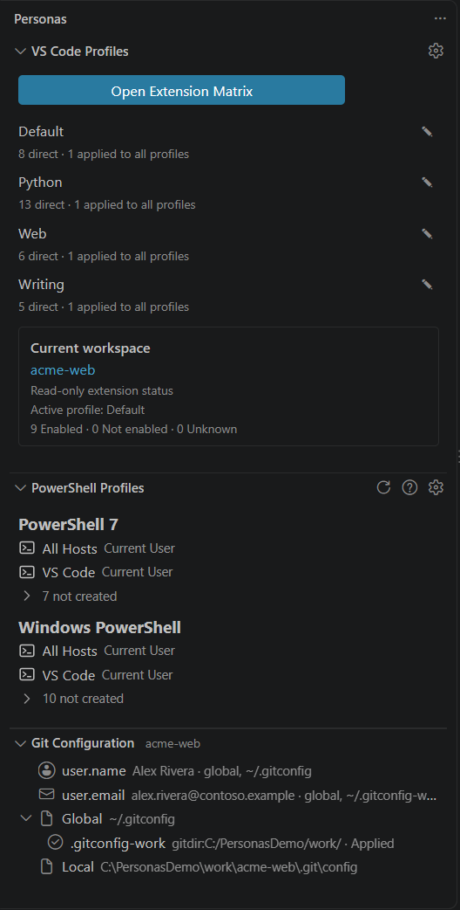

# Personas

**See and manage your developer personas in one sidebar:** VS Code profiles and their extensions, PowerShell profiles, and the Git identity in effect.

If you keep separate setups for work, clients, open source, or teaching, each one is a persona: a VS Code profile with its own extensions, a PowerShell profile, and a Git identity. Personas puts them together in the Activity Bar. You can see what each setup contains and change it in one place, without switching profiles or opening config files to find out what's set where.

## Features

### Extension Matrix: every profile side by side

- Each profile is a column and each extension is a row. Check or clear a cell to install or uninstall that extension in that profile, through VS Code's own `code` command line.
- Hover over an extension's name for its details and quick actions: **Install in every profile**, **Remove from every profile**, and **Apply to all profiles…**.
- Search, filter by category, publisher, or install source, and group by name or publisher. Each filter choice shows how many extensions it matches.
- A **Current workspace** column shows whether each extension is enabled in the open folder or workspace.
- Find orphaned extensions, which are still on disk but in no profile, and move their version folders to the Trash.

### VS Code Profiles

- Every profile, with how many extensions are installed in it directly and how many are applied to all profiles. A ✎ button opens a profile's raw extension list.
- A **Current workspace** card summarizes the extension status of the open folder or workspace.
- Profiles appear in the same order everywhere: Default, then VS Code's Agents window profile, then the rest by name.

### PowerShell Profiles

- Your PowerShell profile scripts, grouped by edition and listed in the order PowerShell loads them. Windows PowerShell appears on Windows.
- Open, create, copy the path of, reveal, or move a profile script to the Trash.
- Finds installations without starting PowerShell, then asks each detected edition for its canonical profile paths in the background with profiles disabled.

### Git Configuration

- The `user.name` and `user.email` in effect for the current repository, and the file each one comes from.
- The system, global, local, and worktree config files, with every `include` and `includeIf` file and whether it applies here.
- **Show Effective Git Configuration** lists every value in the order Git reads it.
- This view is read-only, and it is the first stage of Git personas. Saving and applying named Git identities is planned; see the [roadmap](docs/roadmap.md).

### Built for everyone

Controls follow your VS Code theme, including high contrast. Every cell state has its own symbol as well as its color. The matrix works fully from the keyboard and with screen readers, and keeps your place when it updates.

## Getting started

1. Install **Personas** from the Marketplace.
2. Select the Personas icon in the Activity Bar. The sidebar opens, and so does the Extension Matrix.
3. Check or clear a cell in the matrix to install or uninstall an extension in that profile.
4. Look at the PowerShell Profiles and Git Configuration views to see the rest of your setup.

The [user guide](docs/user-guide.md) covers every feature in detail.

## Requirements and limitations

- VS Code Stable or Insiders 1.101 or newer, on Windows, macOS, or Linux.
- Personas manages the local desktop VS Code install it runs in, including true VS Code Portable Mode and custom `--user-data-dir` and `--extensions-dir` locations. Remote windows (SSH, WSL, dev containers) and VS Code for the Web are not supported.
- The Git Configuration view needs Git, found through VS Code's `git.path` setting or your `PATH`.

## Settings

Select the gear in any Personas view's title bar, or run **Personas: Open Personas Settings**, to open Settings filtered to Personas.

| Setting | Default | What it does |
| --- | --- | --- |
| `personas.extensionMatrix.openWithSidebar` | `true` | Open the Extension Matrix whenever the VS Code Profiles view is shown. |
| `personas.showAgentsWindowProfile` | `true` | Show VS Code's Agents window profile, which uses the Default profile's extensions. |
| `personas.powerShellProfiles.includeWindowsPowerShell` | `true` | On Windows, include Windows PowerShell 5.1 and ISE profiles. |
| `personas.powerShellProfiles.allowRuntimeDiscovery` | `true` | Let detected PowerShell executables report their canonical profile paths in the background. Turn it off to use only passive discovery and the Windows registry fallback. This is a machine setting, so set it in User settings. |

Note: the older setting name `personas.openMatrixOnActivityBarClick` is still honored when `personas.extensionMatrix.openWithSidebar` isn't set.

## Commands

| Command | What it does |
| --- | --- |
| Personas: Open Extension Matrix | Open the matrix of every extension across every profile. |
| Personas: Open Personas Settings | Open User Settings filtered to Personas. |
| Personas: Refresh PowerShell Profiles | Look for PowerShell profiles again. |
| Personas: PowerShell Profiles Help | Explain how profiles are found, with links to the settings and Microsoft Learn. |
| Personas: Refresh Git Configuration | Read the Git configuration again. |
| Personas: Show Effective Git Configuration | Open every Git config value in effect, in the order Git reads it. |

## Privacy

Personas has no telemetry. It reads and changes local files and runs VS Code's `code` command line and `git`. For PowerShell profile discovery, it may start detected PowerShell executables in the background with `-NoProfile`; on Windows, `reg.exe` is the fallback for finding your Documents folder, and `taskkill` stops a command that takes too long. Network access happens only through those tools, for example when the `code` command line downloads an extension you install, or when you open a link.

## Learn more

- [User guide](docs/user-guide.md)
- [Roadmap](docs/roadmap.md)
- [Changelog](CHANGELOG.md)
- [Report an issue or suggest a feature](https://github.com/SamErde/Personas/issues)
- [Contributing](CONTRIBUTING.md)
