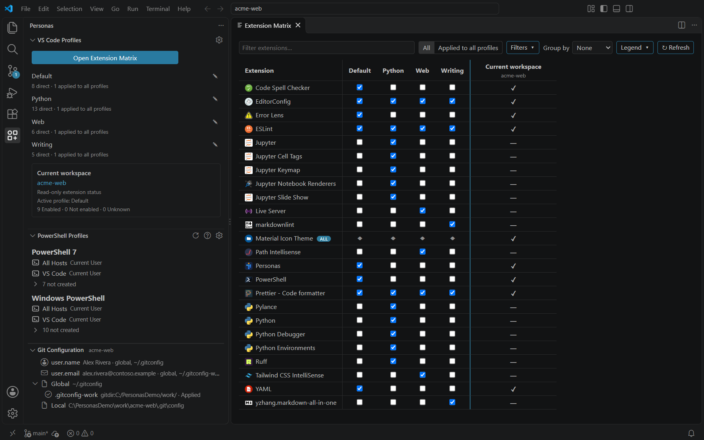
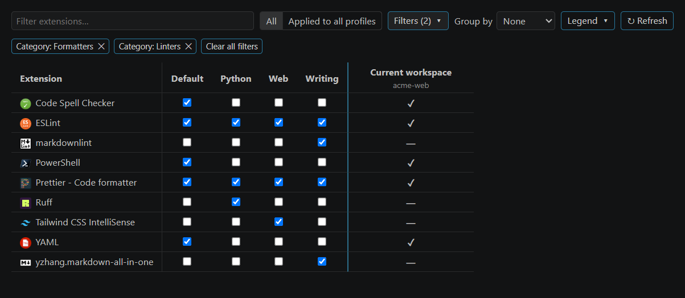
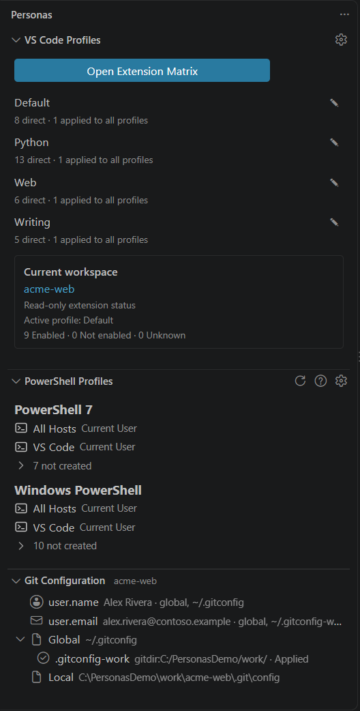

# Personas user guide

This guide covers everything Personas does. The [README](../README.md) has the overview, and the [roadmap](roadmap.md) lists what's planned.

- [The Personas sidebar](#the-personas-sidebar)
- [Extension Matrix](#extension-matrix)
- [Current workspace](#current-workspace)
- [VS Code Profiles](#vs-code-profiles)
- [Orphan cleanup](#orphan-cleanup)
- [PowerShell Profiles](#powershell-profiles)
- [Git Configuration](#git-configuration)
- [Settings](#settings)
- [Commands](#commands)
- [How Personas works](#how-personas-works)
- [Troubleshooting](#troubleshooting)

## The Personas sidebar

Select the Personas icon in the Activity Bar to open the sidebar. It has three views: **VS Code Profiles**, **PowerShell Profiles**, and **Git Configuration**. You can collapse, reorder, or hide them, or move them elsewhere, as with any VS Code view. The `…` on the Personas title shows and hides views.

- **Opening the matrix.** Showing the VS Code Profiles view also opens the Extension Matrix, including when VS Code restores a window that was left with the view showing. Turn this off with `personas.extensionMatrix.openWithSidebar`. Collapsing the VS Code Profiles view also stops it, but only while another Personas view is shown: when only one view is left, VS Code expands it and removes its header, so it can't be collapsed.
- **Sizes.** The first time a workspace shows the sidebar, VS Code Profiles gets the most height and Git Configuration the least. After that VS Code keeps whatever sizes you drag the dividers to, separately for each workspace.
- **Title bar buttons.** Each view has a gear that opens Settings filtered to Personas. VS Code always shows the buttons on the VS Code Profiles and PowerShell Profiles views. It shows Git Configuration's buttons only while you hover over or focus that view. Set `workbench.view.alwaysShowHeaderActions` to show them all the time.

## Extension Matrix

The matrix shows every extension against every profile. Open it from the VS Code Profiles view, or run **Personas: Open Extension Matrix**.

### Cells

Each profile is a column and each extension is a row. A checkbox means you can change that cell: check it to install the extension in that profile, or clear it to uninstall. Uninstalling an extension from the last profile that has it asks you to confirm first.

Cells that can't be changed show a symbol, and each symbol differs in shape as well as color. Select **Legend** for the same list in the matrix.

| Symbol | Meaning |
| --- | --- |
| ◆ | Applied to all profiles: VS Code installs it once for every profile. |
| ⤷ | Installed through Default: the profile uses the Default profile's extensions. |
| ✓ | Installed, can't change here. |
| — | Not installed. |
| ? | Unknown, list could not be read: the profile's extension list couldn't be read. |

An extension applied to all profiles also shows an **ALL** badge beside its name.

### Hover cards and row actions

Hover over an extension's name, or move keyboard focus to it, to see its publisher, description, and install details, with these actions:

For an extension applied to all profiles, only **Apply to all profiles…** appears.

- **Install in every profile** installs the extension separately into each profile. Unlike an extension applied to all profiles, profiles you create later won't get it.
- **Remove from every profile** uninstalls it from every profile where it's installed directly.
- **Apply to all profiles…** opens VS Code's Extensions view at that extension, where you can use VS Code's own **Apply Extension to all Profiles** option. VS Code doesn't let extensions toggle that option themselves.

### Search, filters, and grouping

- **Search** by name, ID, or publisher.
- **All / Applied to all profiles** switches between every extension and only the extensions applied to all profiles.
- **Filters** narrow the list by category, publisher, and install source (Marketplace, VSIX, Other, or Unknown). Each choice shows how many extensions it would match. Active filters appear as chips that you can remove one at a time, or all at once with **Clear all filters**.
- **Group by** arranges rows under A–Z or publisher headings, each with its count.

Your search, filters, and grouping last until the window is closed or reloaded.

### Keyboard and screen readers

- The row and column under the pointer or keyboard focus are highlighted. Extension names stay in view when the matrix scrolls sideways.
- Focus stays where you left it when the matrix updates.
- Screen readers announce each cell's extension, profile, and state, and the number of results as you filter.

### Keeping up to date

The matrix and the VS Code Profiles view refresh by themselves when profiles or extensions change, including changes made in VS Code itself. **Refresh** reads everything again.

## Current workspace

When a folder or workspace is open, the matrix adds a **Current workspace** column, and the VS Code Profiles view adds a **Current workspace** card. They report what VS Code says about the open workspace. They never change it.

| Status | Meaning |
| --- | --- |
| ✓ Enabled | The extension is running in this workspace. |
| ○ Not enabled | The extension is installed but not running here, for a reason Personas can't determine. One possibility is that it is disabled for the workspace. |
| — Not installed in profile | The active profile doesn't have it. |
| ✓ W Workspace-local | An unpacked extension under the workspace's `.vscode/extensions` folder that VS Code is running from there. |
| ? Unknown | There isn't enough evidence for a stronger claim. |

Select an **Enabled**, **Not enabled**, or **Workspace-local** cell to open that extension in VS Code's Extensions view. There you can use VS Code's own **Enable (Workspace)** or **Disable (Workspace)**. No VS Code command line saves workspace enablement, so Personas hands this off to VS Code.

**Workspace files.** For a saved `.code-workspace` file, the card can open the file read-only or for editing. VS Code doesn't keep extension enablement in that file, so editing it doesn't enable, disable, install, or remove extensions.

**Workspace-local extensions.** Each valid unpacked extension under `.vscode/extensions` is listed as a candidate, including ones that exist only in the workspace. Personas calls one `Workspace-local` only when VS Code reports that it's running the extension from that folder. Otherwise it stays `Unknown`. A workspace-only row's profile cells are read-only (—), and it has no row actions.

**Recommendations.** Extension recommendations in `.vscode/extensions.json` or a `.code-workspace` file are only suggestions. Personas never treats a recommendation as installed or enabled.

## VS Code Profiles

The VS Code Profiles view lists every profile in the same order as the matrix: Default first, then VS Code's Agents window profile, then the rest by name. Each profile shows:

- how many extensions are installed in it directly, or how many it uses from Default;
- how many extensions are applied to all profiles;
- a ✎ button that opens the profile's raw extension list. VS Code owns that file, so edit it with care. Profiles that use Default's extensions have no list of their own, so they have no ✎; the Agents window profile shows "Same extensions as Default".

**The Agents window profile** is VS Code's built-in profile for its separate Agents window. It always uses the Default profile's extensions, so its column always matches Default. Hide it with `personas.showAgentsWindowProfile`.

The view also shows the **Current workspace** card and a summary of orphaned extensions, with any warnings about profile data that couldn't be read.

## Orphan cleanup

Extension versions that are on disk but that no profile uses any more are **orphans**. In the matrix, switch to **All** to see them struck through. Select **Review N orphaned…**, or **Review…** in the VS Code Profiles view, to list them with their size and last-modified date. Then move the ones you choose to the Trash or Recycle Bin.

## PowerShell Profiles

The PowerShell Profiles view lists the PowerShell profile scripts that exist, grouped by edition and labeled by host and scope, in the order PowerShell loads them.

- PowerShell 7 is supported on Windows, macOS, and Linux. Windows PowerShell and ISE rows appear only on Windows.
- Locations that have no script yet fold into one collapsed line per edition.
- Current-user files are listed once per edition, while separate installations have their own all-users paths.

**Actions**

- Select a row to open its script in the editor. For a missing file, confirm Create and Open.
- Each row's menu offers **Copy Path**, **Reveal in File Manager**, and **Delete PowerShell Profile…**, which moves the script to the Trash after you confirm.
- Deleting stops if the file has unsaved edits, or if the Trash or Recycle Bin isn't available.
- You can edit a linked profile, but remove the link itself with your file manager. Personas can't guarantee on every platform that only the link, and not its target, goes to the Trash.

**Finding profiles**

- Personas finds profile locations without starting PowerShell, including when you refresh. It respects a redirected Documents folder.
- If an installed edition has a location that can't be found that way, the view says **Runtime discovery is off** beside it. Choose **Open Personas Settings** and turn on `personas.powerShellProfiles.allowRuntimeDiscovery`. It is a machine setting, so set it in User settings.
- Then choose the named executable, for example **Run pwsh.exe to resolve**. Each click starts that PowerShell once, with profiles disabled and a five-second time limit. A successful result is kept for the rest of the session, even if you turn the setting off again.
- On Windows, turn off `personas.powerShellProfiles.includeWindowsPowerShell` to leave Windows PowerShell 5.1 and ISE out of discovery, listing, and editing. PowerShell 7 stays available. This setting can differ between workspaces.

**Help.** The **?** in the view's title bar opens a help dialog. Its **Open PowerShell Settings** button shows the PowerShell Profiles settings, and **Profiles on Microsoft Learn** explains profiles and their load order.

**Current limits.** The view works in local desktop windows only. PowerShell Preview and custom installations aren't discovered yet. WSL support is next; see the [roadmap](roadmap.md).

## Git Configuration

The Git Configuration view answers one question: which Git configuration is in effect here, and where does it come from? It is the first stage of Git personas; saving and applying named identities is [planned](roadmap.md).

- **Current repository.** This is the repository that contains the file in the active editor, or else the first workspace folder. Its name appears in the view's title.
- **Identity.** The view shows the `user.name` and `user.email` in effect, and the file each comes from.
- **Config files.** It then lists the system, global, local, and worktree config files that hold values. Every `include` and `includeIf` file is nested under the file that names it, with the condition as written and one of these statuses:
  - **Applied:** Git takes values from the file for the current repository.
  - **Not applied here:** the file has values, but none are in effect.
  - **Empty:** the file exists and holds no values.
  - **Missing:** the file doesn't exist.

  Personas reads these statuses from Git's own output and doesn't evaluate conditions itself. Each rule is judged on its own, so a file that two rules name can be Applied under one and Not applied here under the other.
- **No repository.** With no repository open, the view shows system and global configuration only, and gives no status for `includeIf` rules.
- **Opening files.** Each file that exists has a button that opens it in the editor, where you edit and save it yourself. Personas never writes, creates, or deletes a Git config file.
- **Show Effective Git Configuration** (in the title bar) opens a read-only document of every value in the order Git reads it, grouped by key, with its scope and source file. It has the same content as `git config --list`, so treat it with the same care if your config holds credentials.
- **Which Git.** The view uses the first Git that VS Code's `git.path` setting names and that exists, or else the one on your `PATH`. It never runs a Git found in the folder being inspected.
- It works in local desktop windows only.

## Settings

Open them with the gear in any Personas view's title bar, or with **Personas: Open Personas Settings**.

| Setting | Default | Scope | Description |
| --- | --- | --- | --- |
| `personas.extensionMatrix.openWithSidebar` | `true` | Window | Opens the Extension Matrix whenever the VS Code Profiles view is shown, including when a window is restored. See [The Personas sidebar](#the-personas-sidebar). |
| `personas.showAgentsWindowProfile` | `true` | Window | Shows VS Code's Agents window profile in the matrix and the VS Code Profiles view. |
| `personas.powerShellProfiles.includeWindowsPowerShell` | `true` | Window | On Windows, includes Windows PowerShell 5.1 and ISE in discovery, listing, and editing. It can differ between workspaces. |
| `personas.powerShellProfiles.allowRuntimeDiscovery` | `false` | Machine | Lets you start a detected PowerShell to find a profile location that can't be found otherwise. Refresh never starts PowerShell. |
| `personas.openMatrixOnActivityBarClick` | `true` | Window | Deprecated. This is the old name of `personas.extensionMatrix.openWithSidebar`, still honored when the new setting isn't set. |

## Commands

| Command | Where | What it does |
| --- | --- | --- |
| Personas: Open Extension Matrix | Command Palette, VS Code Profiles view | Opens the matrix. |
| Personas: Open Personas Settings | Command Palette, gear in each view | Opens User Settings filtered to Personas. |
| Personas: Refresh PowerShell Profiles | Command Palette, PowerShell Profiles title bar | Looks for profiles again, without starting PowerShell. |
| Personas: PowerShell Profiles Help | Command Palette, **?** in the PowerShell Profiles title bar | Opens the help dialog. |
| Personas: Refresh Git Configuration | Command Palette, Git Configuration title bar | Reads the Git configuration again. |
| Personas: Show Effective Git Configuration | Command Palette, Git Configuration title bar | Opens every value in effect. |
| Open Git Config File | Button on each file in Git Configuration | Opens that config file in the editor. |

## How Personas works

- **Reading.** Personas reads the same files VS Code maintains: the profile registry and each profile's extension list. It doesn't read or write VS Code's internal SQLite state.
- **Installing and uninstalling.** All installs and uninstalls go through VS Code's official `code` command line, scoped to the right profile and to custom `--user-data-dir` or `--extensions-dir` locations when you use them.
- **Workspace status.** This also uses VS Code's stable extension API and a limited, read-only scan of each local workspace folder's `.vscode/extensions`.
- **PowerShell and Git.** PowerShell profiles are ordinary files that Personas creates, opens, and moves to the Trash at your request. Git configuration is read with `git` and never written.

The design decisions behind this are recorded as [architecture decision records](adr/).

## Troubleshooting

- **"Personas can't manage profiles in this environment."** Personas manages only the local desktop VS Code install it runs in. Remote windows (SSH, WSL, dev containers) and VS Code for the Web aren't supported.
- **A cell shows `?`.** That profile's extension list couldn't be read. Check the warnings in the VS Code Profiles view, then select **Refresh**.
- **"Running in a development host — Personas manages the install it runs in; run from an installed build."** You're running Personas from source with F5. Install the packaged VSIX instead (see the [build guide](local-build-test-and-release.md)).
- **An extension shows its ID instead of its name.** Some extensions use a translated display name, which Personas doesn't look up yet.
- **The Git Configuration view says Git wasn't found.** Install Git, add it to your `PATH`, or set VS Code's `git.path` setting.
- **A PowerShell location is unresolved.** See runtime discovery under [PowerShell Profiles](#powershell-profiles).
